<picture>
  <source media="(prefers-color-scheme: dark)" srcset="assets/header-dark.svg">
  <source media="(prefers-color-scheme: light)" srcset="assets/header-light.svg">
  
</picture>

 

  &nbsp;
  &nbsp;
  &nbsp;
  

 

<table>
<tr>
<td>

I architect **full-stack web apps**, **Flutter mobile apps**, and **AI-powered developer tools** — from database schema to polished UI. Currently pursuing Computer Science & Engineering at **United International University**, Dhaka.

**What I'm up to right now:**

🧬 Building **GenoNexus** — a genomics platform with Python analysis engines behind a Next.js app  
🔍 Exploring developer tooling that *explains* failures, not just reports them  
🐧 Tinkering with my Arch Linux + Hyprland setup

</td>
</tr>
</table>

 

## 🏗️ Featured Projects

<table>
<tr>
<td width="50%" valign="top">

<h3>🧬 <a href="https://github.com/Anik-tB/GENO_NEXUS">GenoNexus</a></h3>

Genomics platform with role-based portals for researchers, clinicians and patients. Python engines handle sequence analysis &amp; outbreak forecasting, powered by a Gemini research copilot. <strong>🥈 1st runner-up</strong> at the UIU Software Engineering course project showcase.

  
  
  
  
  

  <a href="https://geno-nexus.vercel.app"><strong>▶ Live</strong></a> &nbsp;·&nbsp;
  <a href="https://youtu.be/xAJA6PNAf9w"><strong>🎬 Demo</strong></a> &nbsp;·&nbsp;
  <a href="https://github.com/Anik-tB/GENO_NEXUS"><strong>📂 Code</strong></a>

</td>
<td width="50%" valign="top">

<h3>🔍 <a href="https://github.com/Anik-tB/Ai_Blackbox">AI Black Box Debugger</a></h3>

Catches crashes in Python apps, strips secrets, groups duplicate errors, then combines AST analysis + git blame with AI reasoning to explain root cause and suggest fixes.

  
  
  
  

  <a href="https://github.com/Anik-tB/Ai_Blackbox"><strong>📂 Code</strong></a>

</td>
</tr>
<tr>
<td width="50%" valign="top">

<h3>🌌 <a href="https://github.com/Anik-tB/FinalBTG">Beyond The Galaxy</a></h3>

Space RPG with multiplayer PvP battles, character progression, and an in-game marketplace. <strong>🥇 1st place</strong> at the AOOP project showcase (50+ teams).

  
  
  
  

  <a href="https://final-btg.vercel.app"><strong>🌐 Website</strong></a> &nbsp;·&nbsp;
  <a href="https://github.com/Anik-tB/FinalBTG"><strong>📂 Code</strong></a>

</td>
<td width="50%" valign="top">

<h3>🛡️ <a href="https://github.com/Anik-tB/space-login">SafeSpace</a></h3>

Public-safety platform for incident reporting, live alerts, safety-zone maps and emergency help — built for women and local communities.

  
  
  
  
  

  <a href="https://space-login-seven.vercel.app"><strong>▶ Live</strong></a> &nbsp;·&nbsp;
  <a href="https://youtu.be/4q2guKDmXN0"><strong>🎬 Demo</strong></a> &nbsp;·&nbsp;
  <a href="https://github.com/Anik-tB/space-login"><strong>📂 Code</strong></a>

</td>
</tr>
<tr>
<td width="50%" valign="top">

<h3>💻 <a href="https://github.com/Anik-tB/PersonalGPT-IDE">PersonalGPT IDE</a></h3>

Self-hosted AI coding workspace in the browser: Monaco editor, file tree, terminal and an agent that edits files with diff review. Supports Gemini, OpenAI, Anthropic, Ollama and more.

  
  
  
  

  <a href="https://personal-gpt-ide.vercel.app"><strong>▶ Live</strong></a> &nbsp;·&nbsp;
  <a href="https://github.com/Anik-tB/PersonalGPT-IDE"><strong>📂 Code</strong></a>

</td>
<td width="50%" valign="top">

<h3>🧘 <a href="https://github.com/Anik-tB/MindProtection">MindProtection</a></h3>

Focus & digital-wellbeing app: Pomodoro timer, habit streaks, planner, recovery mode with Android app blocking, and an optional AI coach.

  
  
  
  
  

  <a href="https://github.com/Anik-tB/MindProtection"><strong>📂 Code</strong></a>

</td>
</tr>
</table>

<b>📦 More projects</b>

 

| Project | Description | Stack |
|:--------|:-----------|:------|
| [**Nashwa**](https://github.com/Anik-tB/Nashwa) · [live](https://nashwa-xi.vercel.app) | Marketplace for Bangladeshi artisan crafts | React · Express · Supabase |
| [**IISWPS**](https://github.com/Anik-tB/IISWPS-main) · [live](https://iiswps-main.vercel.app) | Industrial safety monitoring with ML risk prediction | FastAPI · scikit-learn · React |
| [**MediVault**](https://github.com/Anik-tB/MediVault) | Pharmacy ordering: patient app, API & staff dashboard | Expo · Express · PostgreSQL · React |
| [**Anik AI**](https://github.com/Anik-tB/anik-ai) | Self-hosted platform for LLM agents with RAG and memory | Java · Docker |
| [**PC Assistant**](https://github.com/Anik-tB/pc-assistant) | PC automation with voice control and local LLMs | Python · React · Ollama |
| [**Anik Theme**](https://github.com/Anik-tB/omarchy-anik-theme) | Violet desktop theme & shell plugins for Omarchy | QML · Lua · Shell |

 

## ⚡ Tech Stack

<table>
<tr>
<td align="center" width="96">
  
   <b>TypeScript</b>
</td>
<td align="center" width="96">
  
   <b>JavaScript</b>
</td>
<td align="center" width="96">
  
   <b>Python</b>
</td>
<td align="center" width="96">
  
   <b>Java</b>
</td>
<td align="center" width="96">
  
   <b>Dart</b>
</td>
<td align="center" width="96">
  
   <b>Kotlin</b>
</td>
<td align="center" width="96">
  
   <b>C++</b>
</td>
<td align="center" width="96">
  
   <b>PHP</b>
</td>
</tr>
<tr>
<td align="center" width="96">
  
   <b>Next.js</b>
</td>
<td align="center" width="96">
  
   <b>React</b>
</td>
<td align="center" width="96">
  
   <b>Tailwind</b>
</td>
<td align="center" width="96">
  
   <b>Flutter</b>
</td>
<td align="center" width="96">
  
   <b>Node.js</b>
</td>
<td align="center" width="96">
  
   <b>Express</b>
</td>
<td align="center" width="96">
  
   <b>FastAPI</b>
</td>
<td align="center" width="96">
  
   <b>Vite</b>
</td>
</tr>
<tr>
<td align="center" width="96">
  
   <b>PostgreSQL</b>
</td>
<td align="center" width="96">
  
   <b>MySQL</b>
</td>
<td align="center" width="96">
  
   <b>Supabase</b>
</td>
<td align="center" width="96">
  
   <b>Firebase</b>
</td>
<td align="center" width="96">
  
   <b>Docker</b>
</td>
<td align="center" width="96">
  
   <b>Git</b>
</td>
<td align="center" width="96">
  
   <b>Linux</b>
</td>
<td align="center" width="96">
  
   <b>Arch</b>
</td>
</tr>
</table>

 

## 📊 Activity

<picture>
  <source media="(prefers-color-scheme: dark)" srcset="assets/stats-dark.svg">
  <source media="(prefers-color-scheme: light)" srcset="assets/stats-light.svg">
  
</picture>

<picture>
  <source media="(prefers-color-scheme: dark)" srcset="assets/velocity-dark.svg">
  <source media="(prefers-color-scheme: light)" srcset="assets/velocity-light.svg">
  
</picture>

📈 Metrics &amp; sprint velocity regenerated daily from the GitHub API.

 

## 🏆 Recognition

<table>
<tr>
<td>🥇</td>
<td><strong>1st place</strong> — Beyond The Galaxy AOOP Project Showcase, 50+ teams</td>
</tr>
<tr>
<td>🥈</td>
<td><strong>1st runner-up</strong> — Software Engineering Course Showcase (GenoNexus), UIU</td>
</tr>
<tr>
<td>🥈</td>
<td><strong>1st runner-up</strong> — Brainwave Microcontroller Hackathon</td>
</tr>
<tr>
<td>🎓</td>
<td><strong>Academic merit scholarship</strong> — United International University</td>
</tr>
</table>

 

  

  ✨ Built with obsession and too much caffeine

